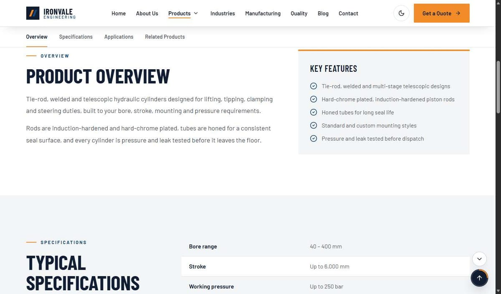

# Industrial Website + CMS

Corporate website for a crane-components and hydraulics manufacturer, with a built-in
PHP/MySQL content management system, a technical blog, lead (CRM-lite) management and
marketing integrations. It runs on any standard PHP host with no framework and no build step on the server.


> **Demo content.** The company name (Ironvale Engineering), contact details, statistics and
> specifications are placeholders. Stock photos are from [Unsplash](https://unsplash.com/license).
> Replace them all before using the site for a real business.

| Website (light) | Website (dark theme) |
|---|---|
|  |  |
| **Product page** | **Admin — pages** |
|  |  |

## Highlights

- **Public site.** Pages:
  - Home, About, Products (with detail pages), Industries, Manufacturing, Quality
  - Blog with categories, search, pagination and RSS
  - Contact, a multi-step Quote form with file upload, legal pages, and HTML and XML sitemaps
- **Blog.** 72 long-form technical articles ship as drafts, with a drip-publishing scheduler.
- **Built for B2B leads.**
  - A multi-item quote list: buyers add several parts with part numbers and quantities to one request.
  - Product datasheets, and a PDF catalogue that can ask for details first (each download becomes a lead).
  - Project case studies and verified certificates that hide themselves after expiry.
  - A lead attribution report by source, campaign and landing page.
- **Operations.**
  - Redirect manager with a 404 log; changed URLs get 301s automatically.
  - Automatic image optimisation to WebP.
  - Nightly backups with retention, a daily sales follow-up email, and tested CI plus auto-deploy.
- **Admin panel (`/admin`).**
  - Content: dashboard, leads pipeline, pages, posts, categories, products, industries, media library,
    menus and settings.
  - Users and roles; trash and restore, revision history, duplication and bulk actions.
- **Integrations.** GA4, Google Tag Manager, Meta Pixel, Microsoft Clarity, Tawk.to chat, WhatsApp button,
  Cloudflare Turnstile and Tunnel, SMTP, Search Console and Bing verification. Tracking loads only after
  cookie consent.
- **Security.** **Passkeys** (Windows Hello, Touch ID/Face ID, Android, security keys), authenticator-app
  codes (TOTP) with recovery codes, optional email codes, password reset, backup email, rate limiting, an
  audit log and CSP. See [SECURITY.md](SECURITY.md).
- **Quality.**
  - Light and dark themes; WCAG 2.2 AA contrast; schema.org JSON-LD.
  - Self-hosted fonts, icons and WebP photos; minified HTML, CSS and JS.
  - Lighthouse 100 for accessibility, best practices and SEO.
- **No frameworks.** Plain PHP 8.1+, MySQL/MariaDB, pre-compiled Tailwind and vanilla JS. Node.js is
  needed only in development, to rebuild assets.

## Requirements

- PHP 8.1+ with `pdo_mysql`, `mbstring`, `dom`, `fileinfo`, `openssl`
- MySQL 5.7+ / MariaDB 10.4+
- Apache with `mod_rewrite` (or Nginx / PHP built-in server)

## Run locally

```bash
npm install                 # first time only (dev tools)
npm run build               # import blog drafts + build CSS, icons, fonts, editor
npm run dev                 # PHP server on http://localhost:8000 + Tailwind watcher
```

Open `http://localhost:8000/install` the first time, or install from the command line:

```bash
php app/cli.php install --db-name=industrial_cms --db-user=root --db-pass= \
  --admin-email=you@company.com --admin-pass="StrongPass123" --site-url=http://localhost:8000
```

## Deploy (Hostinger, cPanel or any PHP host)

1. Run `npm run build` locally (the compiled CSS/JS are committed in `public/assets`).
2. Create a MySQL database + user in your hosting panel.
3. Upload the project. **Best:** point the domain's document root at `/public`.
   If you cannot change the document root, upload everything into `public_html` — the root
   `.htaccess` routes requests into `/public` and blocks `app/`, `database/`, etc.
4. Visit `https://your-domain/install`, enter the database details and create the admin account.
   The installer locks itself afterwards (`app/storage/installed.lock`).
5. Make `public/uploads` and `app/storage` writable. Enable SSL, then uncomment the HTTPS
   redirect in `public/.htaccess`.
6. Admin → Settings: company details, **SEO → site URL**, **Email** (SMTP + lead alerts),
   **Integrations**, and turn off the legal template notice once policies are reviewed.

`app/config.php` (created by the installer) holds the DB credentials and app key — never commit it.
Set `'debug' => false` in production.

## Content management (pages, posts, products)

- **Create, edit, publish, draft and schedule.** Posts also support drip-publishing (Bulk → Schedule).
- **Trash, not instant delete.** Deleting a post or page moves it to the **Trash** tab and unpublishes it
  at once. You can restore it (as a draft) for 30 days, or delete it permanently or empty the Trash.
  System pages (Home, About…) can only be set to Draft, never trashed.
- **Revision history.** Every save keeps the previous version (the last 30 per item) in the editor sidebar,
  which shows which fields differ. **Restore** brings back the content and keeps the current publish
  status. The version you replace is kept too.
- **Duplicate.** Posts, custom/legal pages, products, industries and categories can be copied. A copy
  always starts as a draft with a `-copy` URL.
- **Bulk actions.**
  - Posts: publish, draft, schedule, duplicate, set category, trash, restore, delete permanently.
  - Pages: publish, draft, show or hide from search engines, trash, restore, delete permanently.
  - Pages also have search and filters (Published / Drafts / System / Custom / Trash).

## Website experience

- **Homepage building blocks** (Pages → Home), all editable:
  - **Hero quick-link tiles:** up to 4. Links can be site paths, `https://`, `tel:` or `mailto:`; other
    schemes are blocked.
  - **Scrolling strip** of sectors you supply, or approved client names and logos. It pauses on hover and
    stops for visitors who prefer reduced motion.
  - **Client testimonials:** Admin → Testimonials. One can only be published after you tick that the
    client agreed. The section stays hidden until at least one is published.
- **Heading style:** Settings → Company & Branding. *Industrial* (condensed, uppercase) or *Editorial*
  (self-hosted Playfair Display serif).

- **Light / dark theme.** A toggle sits in the header, and each visitor's choice is remembered. In
  Settings → Company & Branding you can set the default (Light, Dark or Follow device) or hide the toggle.
- **Scroll controls.** Floating up/down buttons with a reading-progress ring can be switched off in the
  same place.
- **Accessibility.** Every text colour meets WCAG 2.2 AA (4.5:1) in both themes, so the primary button
  uses navy text on the brand orange.
- **Integration status.** Settings → Integrations opens with a status panel for Analytics, GTM, Pixel,
  Clarity, Tawk.to, WhatsApp, Turnstile (it warns about test keys), Cloudflare proxy, Search Console,
  Bing, SMTP and cookie consent.

## Lead generation features

- **Quote list.** "Add to quote list" on product pages collects items (kept in the visitor's browser).
  - The quote form shows them as editable rows: part/drawing number, quantity and notes. Visitors can also
    add custom parts.
  - The server checks each line again and takes product names from the catalogue, not from the browser.
  - The admin, the notification email and the CSV export all show the item table.
- **Datasheets and catalogue.**
  - Set a PDF on each product (*Datasheet*). The catalogue PDF is set in Settings → Catalogue & Downloads.
  - The catalogue can ask for name, company and email first. That creates a low-priority *download* lead,
    and the visitor isn't asked again on that device for 30 days.
  - Every download is counted in Reports.
- **Projects / case studies** (Admin → Projects). Each one has challenge, solution, measurable results,
  an optional client quote and the products supplied.
  - Drafts stay private. Publishing adds `/projects` (with an industry filter) to the site and sitemap.
  - It also adds "Projects using …" on product pages and links from industries.
- **Certificates** (Admin → Certificates). Upload only genuine certificates.
  - Valid ones appear on the Quality page.
  - Expired ones disappear automatically, and administrators get emails 30 and 7 days before expiry.
- **Reports** (Admin → Reports).
  - Leads, qualified, quoted, won, win rate, won value and open pipeline.
  - Grouped by source, medium, campaign, landing page, form, product or month, for any period.
  - A 12-month trend, click and download counts, and CSV export. UTM tags come from the visitor's
    landing URL.

## Redirects, images, backups and automation

- **Redirects & 404s** (Admin → Redirects & 404s).
  - 301/302/307/308 rules, including `/old-section/*` → `/new/*` wildcards, with hit counts.
  - CSV import and export, and protection against loops.
  - The 404 log lists missing addresses people requested, with a one-click "Redirect".
  - Changing the URL of a published page, post, product or project adds a 301 automatically.
- **Image optimisation.** Uploads are processed automatically:
  - rotated upright, capped at 2560 px, with EXIF/GPS metadata removed
  - converted into WebP sizes (480–1600 px) that pages serve with `srcset`
  - Older uploads can be processed with **Media → Optimise now**. This needs PHP's GD extension
    (standard on Hostinger and cPanel hosts).
  - The media library also stores PDFs (checked by file signature).
- **Backups** (Admin → Backups & automation).
  - A gzip SQL dump made in pure PHP (no `mysqldump` needed), with optional zipped uploads.
  - Runs nightly and keeps the newest N.
  - Downloading a backup requires your password. To restore:
    `php app/cli.php restore backup-….sql.gz --yes`.
- **Scheduled tasks.** Add one cron job (hPanel/cPanel → Cron Jobs), every 10 minutes:
  `php /path/to/site/app/cli.php cron`. A secret URL is offered for hosts without cron. It runs:
  - the daily lead follow-up email: overdue and due-today follow-ups, plus new leads not contacted
    within 24 h; each salesperson gets only their own leads
  - backups and certificate warnings
  - the Trash purge and old-log clean-up

  The admin shows a warning if cron stops running.

## Stock photos

Demo photos are Unsplash images. `npm run images` downloads every photo the site references
(code, seed data and database) into `public/assets/stock/` as WebP (480–2400 px), and
`img_tag()` serves those local copies automatically. Pages then never wait on images.unsplash.com.
Re-run it after pasting a new Unsplash URL in the admin; until then that photo loads from Unsplash.
Replace the stock photos with your own photography before launch.

## Admin roles

| Role | Access |
|---|---|
| Administrator | Everything, incl. settings, integrations and users |
| Editor | Pages, blog, categories, products, industries, media |
| Sales | Dashboard and leads |

## Admin sign-in & account security

- **Passkeys** (My profile → Passkeys). Sign in with a fingerprint, face or device PIN instead of a
  password, using Windows Hello, Touch ID / Face ID, Android or a security key.
  - Passkeys can't be phished and already include two-factor protection. The browser can offer them
    straight from the username field.
  - A passkey works only on the exact domain it was created on; add it again after moving domains.
  - The implementation is standard WebAuthn (ES256/RS256, user verification required, signature-counter
    clone detection) with no third-party library.
- **Authenticator app (TOTP).** Scan a QR code with Google/Microsoft Authenticator, 1Password, Bitwarden
  and so on.
  - The secret is encrypted at rest and codes can't be reused.
  - Ten single-use recovery codes are shown once.
  - Users with an app enabled always enter its code after their password.
- **Sign in with email or username.** Wrong passwords are rate limited (5 per account+IP and
  20 per IP per 15 minutes), and every sign-in event is written to an audit log
  (Admin → Settings → Security, and *My profile → Recent security activity*).
- **Two-step email codes (OTP).** Turn on in Settings → Security once SMTP has passed a test
  email. The 6-digit codes expire after 10 minutes, allow 5 attempts, can be resent after 60 s, and are
  limited to 5 per 15 minutes. Codes are stored hashed. Users can trust a browser for N days, and can
  have the code sent to their verified backup email instead.
- **Forgot / reset password** (`/admin/forgot`). A reset code is emailed to the primary address and the verified backup
  email. The response is identical whether or not the account exists. Codes are single-use, and a
  reset signs out every other session and trusted browser.
- **My profile** (`/admin/profile`):
  - name and username
  - change password (needs the current password)
  - change sign-in email: a code goes to the *new* address and a notice to the old one
  - add, change or remove a backup email: verified by a code, and removal needs the current password
- Every sensitive change emails a security notice. Re-entering the current password is rate limited.
- **Cloudflare Turnstile** protects the login, forgot-password, contact and quote forms when keys are
  set (Settings → Integrations). For local testing, use Cloudflare’s test keys: site key
  `1x00000000000000000000AA`, secret `1x0000000000000000000000000000000AA`. **Replace them with real
  keys in production.**
- **Locked out?** `php app/cli.php reset-password --email=… --pass=…` or `php app/cli.php otp --off`.
- **Debug mode** (`'debug' => true` in `app/config.php`):
  - every email is saved to `app/storage/mail` (Settings → System → Dev mailbox)
  - codes are shown on screen
  - Never enable debug mode on a live site.

## Leads (CRM-lite)

Contact and quote forms save to the database (with attachments stored privately in
`app/storage/leads`). Each lead has status pipeline (New → Contacted → Qualified → Quoted →
Negotiation → Won/Lost/Spam), priority, owner, follow-up date, estimated value, tags and an
activity timeline (notes, calls, emails, automatic status history). Filters, search, bulk
actions and CSV export are included. UTM source/medium/campaign and landing page are captured.
Spam protection: signed time token, honeypot, rate limiting and optional Cloudflare Turnstile.
Email alerts and optional customer auto-reply use the SMTP settings.

## Blog workflow

- 72 technical articles (8 categories, ~59,000 words, each with an FAQ section and FAQPage
  schema) ship as **drafts** in `content/posts/*.md`.
- Have an engineer review each article, then in Admin → Blog Posts select drafts and use
  **Schedule (drip-publish)** — e.g. one every 3 days. Steady publishing is better for SEO
  than releasing everything at once.
- Editing source files: change `content/posts/*.md` (+ FAQs in `_faq-*.md`), then
  `npm run posts && php app/cli.php import-posts --refresh` (only updates posts still in draft).

## Integrations (Admin → Settings → Integrations)

Google Analytics 4, Google Tag Manager, Meta Pixel, Microsoft Clarity, Tawk.to live chat,
WhatsApp floating button + per-page WhatsApp links, Cloudflare Turnstile, Cloudflare proxy /
Tunnel real-IP support, Google/Bing verification and custom head/body code.
Tracking scripts only load after the visitor accepts cookies, and the Cookie Policy table
updates automatically from the enabled integrations.

**Cloudflare Tunnel (expose local/private server):**
`cloudflared tunnel --url http://localhost:8000` — then enable “behind Cloudflare proxy or
Tunnel” in Integrations and set the public URL in Settings → SEO.

## Project structure

```
app/            PHP application (not web-accessible)
  handlers/     request handlers (site, admin, leads, content, settings, installer)
  lib/          helpers, db, auth, fields (form builder), templates, mailer, integrations
  views/        site/ and admin/ templates
  storage/      logs, lead attachments, install lock (keep private)
  config.php    generated by installer
content/posts/  blog drafts (Markdown) + FAQ add-ons
database/       schema.sql, seed/site.json, seed/posts.json
public/         web root: index.php, assets/, uploads/
resources/      Tailwind entry file
scripts/        dev tooling (asset build, post import, dev server)
```

## CLI

```bash
php app/cli.php migrate                 # apply schema upgrades (safe to re-run)
php app/cli.php cron [--force]          # scheduled tasks — add to the server's cron every 5–15 min
php app/cli.php backup [--uploads]      # back up now
php app/cli.php restore <file> --yes    # restore a backup (replaces the database)
php app/cli.php otp --on|--off          # toggle email two-step sign-in
php app/cli.php import-posts [--refresh]
php app/cli.php create-admin --email=… --pass=… [--name=…]
php app/cli.php reset-password --email=… --pass=…
```

## Tests, CI and deployment

```bash
npm run dev     # in one terminal
npm test        # end-to-end suite against http://localhost:8000 (BASE_URL, ADMIN_LOGIN, ADMIN_PASSWORD to override)
```

- **What the tests cover.** The suite in `tests/` drives the real site over HTTP:
  - redirects, the quote list, image optimisation and PDF uploads, gated downloads
  - projects, certificates, reports
  - a backup restored into a **temporary** database, and cron
  - passkeys, using a software authenticator: registration, sign-in, replay, wrong-site and cloned-key
    rejection
  - the authenticator app, including recovery codes

  Everything a test creates is removed afterwards.
- **CI.** `.github/workflows/ci.yml` runs on every push and PR:
  - PHP 8.1 and 8.4 against MariaDB
  - syntax checks, an asset build, a fresh install and the full suite
  - it fails on any PHP warning
- **Deploy.** `.github/workflows/deploy.yml` deploys after CI passes on `main`.
  - Add `DEPLOY_SSH_*` secrets (rsync + migrations) or `DEPLOY_FTP_*` secrets (FTPS); the workflow file
    lists them.
  - Until secrets are set, the deploy step is skipped.
  - Config, storage and uploads on the server are never overwritten.

## Before launch

- Replace demo company details, statistics, specifications, equipment list and images.
- Have the legal pages reviewed by a lawyer (they are templates), then turn off the notice.
- Configure SMTP and test it, set lead notification recipients, add real Turnstile keys.
- Set `debug` to false and give every admin a passkey or authenticator app, plus a backup email.
- Add the cron job (Backups & automation shows the exact command) and download one backup to keep off-site.
- Review and schedule blog drafts; verify every technical claim with your engineers.
